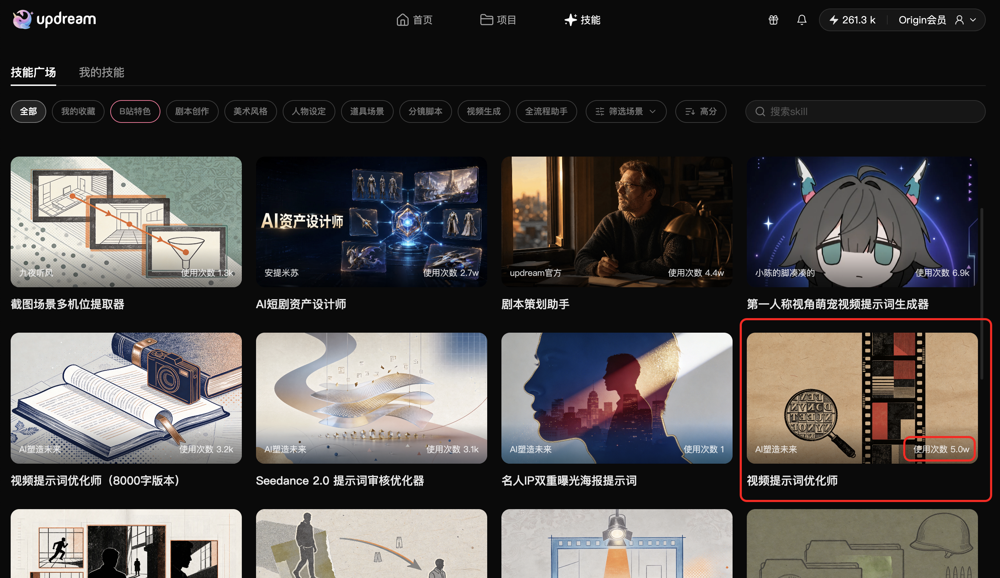

# Seedance 提示词优化师

面向 Seedance 2.0 视频生成的中文提示词优化 Skill。它将简短创意整理为包含人物、环境、灯光、分镜和生成规范的完整视频提示词。

## Updream 展示

随附截图来自 Updream 技能广场的高分排序页面，展示“视频提示词优化师”条目及约 5.0 万次使用。截图中的展示数据来自用户提供的图片，平台统计可能随时间变化。

## 跨平台使用

本 Skill 可用于支持调用 Skill 的应用，也可用于 GitHub 相关应用工作流。将 `video-prompt-optimizer.md` 作为技能说明导入或粘贴到目标应用；具体导入方式取决于该应用的 Skill 功能。

## 文件

- `video-prompt-optimizer.md`：完整技能定义
- `cover-updream-skill-listing.png`：Updream 技能广场截图
